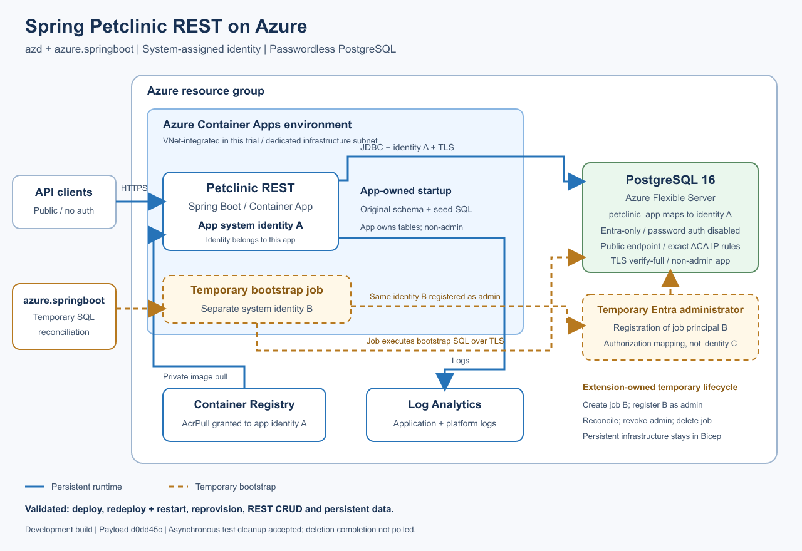

# Petclinic REST on Azure

A standalone azd template for the Spring Petclinic REST API (no web UI) on
Azure Container Apps with PostgreSQL 16. Managed identity authenticates to the
database and Container Registry; no database password or Key Vault is needed.
The `azure.springboot` extension required by `azure.yaml` packages the application,
deploys the service module, and reconciles PostgreSQL access.

**Demo only:** the API is public and unauthenticated. The app is a non-admin
database user, but can create and manage its own tables. Do not use sensitive data.

## Architecture



See the [editable diagram](docs/images/architecture.svg) and
[gallery submission assets](docs/gallery.md).

## Deploy

This branch requires a development build of the `azure.springboot` extension
with extension-owned PostgreSQL job bootstrap support; installing azd alone
does not provide that unreleased capability. See the
[extension development instructions](https://github.com/Azure/azure-dev/tree/main/cli/azd/extensions/azure.springboot)
and install the corresponding development build before deployment.
The deployment also needs its release-configured bootstrap runner image.

Install [azd](https://aka.ms/azd-install) 1.37.2 or newer, Azure CLI, Docker, and PowerShell 7.
Start Docker and sign in to both CLIs with a user account in the target tenant:

```sh
az login
azd auth login
azd init -t https://github.com/XiaofeiCao/petclinic-rest-azd/tree/postgres-job-bootstrap
azd up
```

Choose an environment, subscription, location, and database size.

| Size | Compute | Storage |
|---|---|---|
| `small` (default) | B1ms: 1 vCore, 2 GiB RAM | 32 GiB |
| `larger` | B2s: 2 vCores, 4 GiB RAM | 32 GiB |

Both are burstable demo configurations, not production tiers. Regional SKU
availability and subscription quota apply. For automation, set `DATABASE_SIZE`
with `azd env set` before provisioning; `--no-prompt` uses small unless saved.

### Subscriptions requiring VNet integration

The default deployment does not create a customer-managed VNet. If Azure Policy
requires the Container Apps environment to use one, select a fresh environment
and enable the published option **before the first provision**:

```sh
azd env set AZURE_USE_VNET true
azd up
```

This template substitution selects the Bicep `useVirtualNetwork` parameter.
It creates a dedicated VNet and `/23` infrastructure subnet; HTTPS ingress and
the PostgreSQL endpoint remain public. It does not create private endpoints,
a NAT gateway, or policy-exemption tags. The extension still reconciles only
the Container Apps environment's exact outbound-IP database firewall rules.
VNet integration is fixed when the environment is created; do not toggle this
setting on an existing deployment. Use a fresh environment to change topology.

Use a **fresh environment** when upgrading from a password-based or
user-assigned-identity version.
Reprovisioning does not migrate data or delete retired MySQL, Key Vault, jobs,
identities, secrets, or permissions.

The deploying identity needs resource creation and role-assignment permissions,
such as Contributor plus Role Based Access Control Administrator at subscription
scope. Preflight hooks select the signed-in Azure CLI user as PostgreSQL Entra
administrator before `azd up` resolves infrastructure parameters and before
standalone `azd provision`. Service-principal-only provisioning is not supported.
The lookup uses the existing ARM credential; no Microsoft Graph access is required.

Provisioning first creates the Container App with a public placeholder and its
system-assigned identity, grants that principal `AcrPull` on the registry, and
configures registry authentication as `system`. The service deployment keeps the
same identity when switching to the private application image. Reprovisioning
preserves the running image and identity.

After provisioning, the extension verifies the exact Container Apps outbound-IP
firewall rules and maps the application identity to `petclinic_app`. SQL
reconciliation runs from a short-lived Container Apps job in the deployed
environment. The job receives temporary administrator access only for the bounded
execution window, then the extension removes that access before deleting the job.
The job has its own system-assigned identity, distinct from the application's.
Its temporary PostgreSQL Entra administrator registration authorizes that same
job principal; it is not another identity or an Azure RBAC role assignment.
No unrestricted PostgreSQL firewall rule is created.

Petclinic runs its original schema and seed SQL at startup. Restarting can restore
deleted sample records. Azure activates the passwordless `azure-postgres` profile;
the existing password-based `postgres` profile remains available for explicit local
development.

## Call the API

Use the app hostname from the HTTPS endpoint printed by azd:

| Endpoint | URL |
|---|---|
| Vets API | `https://<app-host>/petclinic/api/vets` |
| Swagger UI | `https://<app-host>/petclinic/swagger-ui.html` |
| Health | `https://<app-host>/petclinic/actuator/health` |

```sh
curl "https://<app-host>/petclinic/api/vets"
```

## Run locally

With JDK 17 installed, run from the project root:

```sh
sh ./mvnw spring-boot:run
```

On Windows PowerShell, use `.\mvnw.cmd spring-boot:run`.
The default `h2,spring-data-jpa` profiles use an in-memory database; no Azure
resources or firewall changes are needed. Data is lost when the process stops.
Open [Swagger UI](http://localhost:9966/petclinic/swagger-ui.html),
[the vets API](http://localhost:9966/petclinic/api/vets), or
[health](http://localhost:9966/petclinic/actuator/health). Stop with Ctrl+C.

## Security and troubleshooting

- Ingress is HTTPS-only; the bootstrap image has no public ingress.
- PostgreSQL password authentication is disabled. The JDBC authentication plugin
  obtains tokens using the app's system-assigned managed identity, without an
  `azure.clientId` or `AZURE_CLIENT_ID` selector.
- Database connections verify the TLS certificate and hostname.
- The app owns its tables and has `USAGE, CREATE` on the `public` schema.
  It is not a read/write-only database role.
- Firewall rules named `aca-<IPv4-address-with-hyphens>` are template-owned.
  Reprovisioning removes obsolete rules and preserves unrelated rules, which can
  grant additional access. Reprovision if app outbound IPs change.
- A customer-managed VNet is created only when `AZURE_USE_VNET=true` is selected
  before provisioning. Neither topology creates private endpoints or a
  fixed-egress NAT gateway. An IP firewall is not workload identity isolation;
  database authentication remains required.
- Do not commit `.azure/` or publish its contents.

If identity bootstrap fails, check the signed-in tenant and the redacted Container
Apps job diagnostic printed by the extension. Rerun `azd provision` after
correcting the cause. Do not add an unrestricted PostgreSQL firewall rule.

## Clean up

```sh
azd down
```

This deletes the database and application resources, including their data.
Database, container, registry, and logging usage incur Azure charges.

## Local checks and upstream source

With JDK 17 and the deployment prerequisites installed:

```sh
sh ./mvnw --batch-mode --no-transfer-progress verify
az bicep build --file infra/main.bicep
az bicep build --file infra/application.bicep
pwsh -File tests/Test-ManagedIdentityProfile.ps1
docker build --tag petclinic-rest:test .
pwsh -File tests/Test-ApplicationDatabase.ps1 -ApplicationImage petclinic-rest:test
```

The database test checks non-admin application startup and restart with a local
password fixture, not Azure authentication. The managed-identity profile test
checks template wiring and profile separation; a live Azure deployment is needed
to verify managed identity and extension-owned SQL bootstrap end-to-end.

`src/main/java/` is unchanged from upstream commit
[`afc8fc1`](https://github.com/spring-petclinic/spring-petclinic-rest/tree/afc8fc1d3b8ec8de69414482b3bd70a1da78cb95).
The template adds `application-azure-postgres.properties` for the passwordless
Azure profile, and `pom.xml` adds `azure-identity-extensions` for passwordless JDBC authentication.
See [UPSTREAM.md](UPSTREAM.md), [NOTICE](NOTICE), and [LICENSE.txt](LICENSE.txt).
